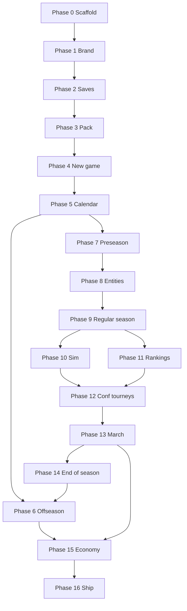

# Build checklist — implementation order (phase map)

**Product:** Dynasty: College Basketball · **Studio:** Novux Games  
**Planning:** [`planning/`](../planning/) is authoritative for behavior — map of all specs: [`planning/README.md`](../planning/README.md).  
**Code:** [`docs/ARCHITECTURE.md`](ARCHITECTURE.md) · Android project: [`android/`](../android/)

> **Honest ship tracking:** Use **[`MEGA_BUILD_CHECKLIST.md`](MEGA_BUILD_CHECKLIST.md)** ( **722** granular items, no deferrals) before trusting `[x]` rows below. The phase table was a **delivery order** guide; many steps were marked complete while specs are still `PARTIAL`/`STUB` in code — see audit shards under [`MEGA_BUILD_CHECKLIST_AUDIT/`](MEGA_BUILD_CHECKLIST_AUDIT/).

Use phases **in order** for greenfield sequencing. Mark `[x]` here only when the matching **MEGA** IDs for that topic are actually `DONE`/`PASS` on device.

**Planning sync:** Every **Done** topic in [`planning-notes.md`](../planning/planning-notes.md) must map to step(s) below ([index](#locked-specs--build-steps-index)). Update **Build**, **Done when**, and the index in the **same commit** as the planning change — no orphan specs.

### Locked specs → build steps (index)

**All planning files:** categorized list in [`planning/README.md`](../planning/README.md).

| Planning doc | Build steps |
|--------------|-------------|
| [`app-shell.md`](../planning/app-shell.md) | 0.2, 1.2 |
| [`branding.md`](../planning/branding.md) | 1.1, 1.4–1.5, 16.5 |
| [`coach-card.md`](../planning/coach-card.md) | 4.2, 8.3, 8.5, 15.4; medical staff → **8.7** duration |
| [`dashboard-tasks.md`](../planning/dashboard-tasks.md) | 6.14, 6.16, 9.6, 9.7, 9.11; injury optional tasks → **9.6** |
| [`game-design.md`](../planning/game-design.md) | 2.3, 4.7, 9.3–9.4, 12.1, 14.2, 15.1–15.5, 16.1–16.4; RS cap → **7.3–7.4** |
| [`game-frame.md`](../planning/game-frame.md) | 6.16, 7.6, 9.1–9.2, 9.6–9.10, 9.12, 10.5–10.6, 14.3 |
| [`awards.md`](../planning/awards.md) | **9.12** hub UI, **14.3** compute + archive; EoS after win contribution |
| [`history-hub.md`](../planning/history-hub.md) | **14.3** GOAT/HOF, **9.10**, School hub records/HOF; win contribution → **14.3** + [`simulation-engine`](../planning/simulation-engine.md#season-win-contribution-design-lock) |
| [`game-start.md`](../planning/game-start.md) | 1.3, 2.2, 2.5, 4.1–4.6 |
| [`injuries.md`](../planning/injuries.md) | **2.6**, **5.3**, **8.7–8.8**, **9.4**, **9.6–9.8**, **10.2**, **10.8** |
| [`in-season-systems.md`](../planning/in-season-systems.md) | **2.6**, **8.9–8.10**, **9.6–9.7**, **10.1–10.2**, **15.4** (chemistry) |
| [`league-branding.md`](../planning/league-branding.md) + [`2026-NCAA-Directory.md`](../planning/2026-NCAA-Directory.md) | 3.1–3.2, 9.3 |
| [`ncba-branding.md`](../planning/ncba-branding.md) | 7.3, 9.5, 11.5, 13.2 |
| [`news-hub.md`](../planning/news-hub.md) | 9.8–9.9, 14.2; injury stories → **9.8** |
| [`notifications.md`](../planning/notifications.md) | **9.1** Dashboard feed, **16.1** settings stub |
| [`offseason.md`](../planning/offseason.md) | 4.6, 6.1–6.10, 14.4 |
| [`player-archetypes.md`](../planning/player-archetypes.md) | 8.2 |
| [`player-cards.md`](../planning/player-cards.md) | 8.1, 8.6; injury strip → **8.1** + **8.7** |
| [`player-loyalty-promises.md`](../planning/player-loyalty-promises.md) | 6.3, 8.6, 14.x declare |
| [`positions-and-lineup.md`](../planning/positions-and-lineup.md) | 8.1, 10.2; injury auto lineup → **8.7**, **10.2** |
| [`postseason-frame.md`](../planning/postseason-frame.md) | 13.4 |
| [`postseason.md`](../planning/postseason.md) | 5.5, 11.5, 12.1–12.2, 13.1–13.5 |
| [`preseason.md`](../planning/preseason.md) | 7.1–7.6, 10.7 |
| [`recruiting-engine.md`](../planning/recruiting-engine.md) | 2.6, 6.5, 6.8, 6.11–6.13, 6.15–6.21, 7.2, 9.9–9.10, 14.1, 15.1, 15.6 |
| [`season-review.md`](../planning/season-review.md) | 5.6, 14.1 |
| [`selection-engine.md`](../planning/selection-engine.md) | 11.1–11.5 |
| [`simulation-engine.md`](../planning/simulation-engine.md) | 10.1, 10.8, 14.3 (win contribution rollup), 6.16 |
| [`strategy-schemes.md`](../planning/strategy-schemes.md) | 4.3, 10.3–10.5 |
| [`time-system.md`](../planning/time-system.md) | 5.1–5.6, 9.2, 9.5, 9.7, 12.3, 13.5 |
| [`transfer-portal.md`](../planning/transfer-portal.md) | 6.3, 6.12, 6.14, 9.9 |

---

## How to read each step

| Field | Meaning |
|-------|---------|
| **Build** | What to implement |
| **Done when** | Acceptance / test |
| **Spec** | Planning link(s) |
| **Code** | Target module/package |

---

## Phase 0 — Repository & CI (baseline)

| Step | Build | Done when | Spec | Code |
|------|--------|-----------|------|------|
| 0.1 | `[x]` Gradle multi-module `:app` + `:core` | `:core:test` green | [ARCHITECTURE](../docs/ARCHITECTURE.md) | `android/` |
| 0.2 | `[x]` Studio → Splash → Home Compose nav | Manual cold start flow | [app-shell](../planning/app-shell.md) | `ui.shell`, `DynastyApp` |
| 0.3 | `[x]` CI workflow (`:core:test` on every PR) | GitHub Action passes | — | `.github/workflows/core-test.yml` |
| 0.4 | `[x]` Android assemble on tag/manual | `:app:assembleDebug` artifact | — | `.github/workflows/android-assemble-debug.yml` |
| 0.5 | `[x]` Save migration on Room bump (ruleset columns v3→4) | `MIGRATION_3_4` + mapper round-trip | [ADR-001](ADR-001-dynasty-save-backend.md#app-updates--save-compatibility), [ADR-002](ADR-002-balance-ruleset-bundle.md) | `dynasty_metadata`, `:database` test |
| 0.6 | `[x]` Play **signed release AAB** CI | `android-bundle-release.yml` green; upload keystore secrets; `targetSdk` policy; R8 `mapping.txt` artifact | [ANDROID_RELEASE_CI.md](ANDROID_RELEASE_CI.md), [branding](../planning/branding.md) | `.github/workflows/android-bundle-release.yml` |

---

## Phase 1 — Brand, assets, app polish

| Step | Build | Done when | Spec | Code |
|------|--------|-----------|------|------|
| 1.1 | `[x]` Wire `Public-Assets/app-logo.svg` on splash | Logo renders sharp on `#181a25` | [branding](../planning/branding.md) | `SplashScreen`, `drawable-nodpi/app_logo.png` |
| 1.2 | `[x]` Novux studio lockup from `Novux_Logos/` | Studio screen ≠ game splash | [app-shell](../planning/app-shell.md) | `StudioScreen`, `novux_studio_lockup.png` |
| 1.3 | `[x]` Settings: skip studio intro, audio stubs | Flags persist | [game-start](../planning/game-start.md) | `data/settings/AppSettingsRepository` |
| 1.4 | `[x]` Credits + unofficial disclaimer screen | Legal copy from branding | [branding](../planning/branding.md) | `CreditsScreen` |
| 1.5 | `[x]` Adaptive icon from `Public-Assets/app-logo.svg` (safe zone) | `python3 planning/tools/generate_adaptive_icon.py`; `generate_adaptive_icon.py --check` green in CI; launcher mask QA on device vs `adaptive-icon-canvas.png` | [branding](../planning/branding.md) | `planning/tools/generate_adaptive_icon.py`, `ic_launcher*.xml`, `ic_launcher_foreground.png` |

---

## Phase 2 — Persistence & save model

| Step | Build | Done when | Spec | Code |
|------|--------|-----------|------|------|
| 2.1 | `[x]` **Choose & document** save backend (SQLite vs JSON files) | ADR in `docs/` | [game-design](../planning/game-design.md#identity-packs--save-model) | [`ADR-001`](ADR-001-dynasty-save-backend.md) |
| 2.2 | `[x]` Save slots API (list, load, delete, last played) | Home **Continue** / **Load** real | [game-start](../planning/game-start.md) | `:database`, `data/save`, `LoadGameScreen` |
| 2.3 | `[x]` Dynasty metadata schema (`seasonIndex`, `phase`, `packId`) | Round-trip one empty dynasty | [game-design](../planning/game-design.md) | `:core`, Room `dynasty_metadata`, **New** bootstrap |
| 2.4 | `[x]` **Week advance** checkpoint semantics | Replay before advance; lock after | [game-design](../planning/game-design.md) | `:core/calendar/checkpoint`, Room `dynasty_calendar` + `provisional_games` |
| 2.5 | `[x]` Unreadable-save handling on Load | Validate + repair calendar; fallback delete UI | [game-start](../planning/game-start.md) | `DynastySaveValidator`, `SaveLoadUnavailableDialog` |
| 2.6 | `[x]` **Balance ruleset** loader + pin on dynasty | Loads & pins: scholarship **15**, `recruiting.*`, loyalty, `nil.*`, `injuries.*`, `discipline.*`, `chemistry`, `fatigue` | [ADR-002](ADR-002-balance-ruleset-bundle.md), [`balance-2026.json`](../assets/balance/balance-2026.json) | `:core/balance` |
| 2.7 | `[x]` **Sim tuning** loader + pin on dynasty | `simSchemaVersion`; possession tables load in sim module | [ADR-003](ADR-003-sim-tuning-bundle.md) | `:core/sim/tuning` |

---

## Phase 3 — Identity pack (default 365)

| Step | Build | Done when | Spec | Code |
|------|--------|-----------|------|------|
| 3.1 | `[x]` Pack schema (`packVersion` 1 — `teamId`, `confId`, templates) | Validator rejects bad JSON | [game-design](../planning/game-design.md#identity-packs--save-model) | `:core/pack` |
| 3.2 | `[x]` Ship **default pack** asset from league branding | 365 teams, 32 conferences | [league-branding](../planning/league-branding.md) | `assets/pack/embedded-default.json` |
| 3.3 | `[x]` Display overlay (names, colors) without corrupting history | Swap pack; IDs stable | [game-design](../planning/game-design.md) | `PackRepository`, `IdentityPackIndex` |
| 3.4 | `[x]` Import URL/TXT path (player UI deferred to **Phase 4** step 4) | Attestation + parse pipeline | [game-start](../planning/game-start.md), [game-design](../planning/game-design.md) | `IdentityPackImportPipeline`, `PackRepository` |

---

## Phase 4 — New dynasty wizard

| Step | Build | Done when | Spec | Code |
|------|--------|-----------|------|------|
| 4.1 | `[x]` Nav: Home → multi-step **New** | Back stack works | [game-start](../planning/game-start.md) | `ui.newgame` |
| 4.2 | `[x]` Coach info + avatar presets | Saved on coach entity | [game-start](../planning/game-start.md), [coach-card](../planning/coach-card.md) | `:core` + UI |
| 4.3 | `[x]` Archetype + default O/D schemes | Matches strategy presets | [game-start](../planning/game-start.md), [strategy-schemes](../planning/strategy-schemes.md) | `:core` |
| 4.4 | `[x]` Dynasty toggles (auto-upgrade, unlimited age) | On save metadata | [game-start](../planning/game-start.md) | — |
| 4.5 | `[x]` School picker (prestige ≤40, unlock all) | Summary sheet + contract preview | [game-start](../planning/game-start.md) | UI + pack |
| 4.6 | `[x]` Sign contract → bootstrap **Offseason Week 1** | Season 1, no carousel | [offseason](../planning/offseason.md), [game-start](../planning/game-start.md) | `domain/bootstrap` |
| 4.7 | `[x]` Generate Season 1 roster (starters, class years) | 15-man cap path started | [game-design](../planning/game-design.md) | `:core` |

---

## Phase 5 — Calendar kernel

| Step | Build | Done when | Spec | Code |
|------|--------|-----------|------|------|
| 5.1 | `[x]` `CalendarPhase` state machine | All phases in [time-system](../planning/time-system.md) | [time-system](../planning/time-system.md) | `:core/calendar` |
| 5.2 | `[x]` Exhibition weeks 1–3 labels | Advancing empty exhib week OK | [time-system](../planning/time-system.md) | — |
| 5.3 | `[x]` RS weeks 1–32 + bye weeks (events, conf, postseason) | Unit tests for bye logic; bye **advance** ticks injury `weeksRemaining` | [time-system](../planning/time-system.md), [injuries](../planning/injuries.md) | `:core` tests |
| 5.4 | `[x]` Conf-tourney week count = **pack max rounds** | Short conf byes while others play | [time-system](../planning/time-system.md) | — |
| 5.5 | `[x]` Postseason **7** league weeks always | Non-participant can advance + view brackets | [time-system](../planning/time-system.md), [postseason](../planning/postseason.md) | — |
| 5.6 | `[x]` **End of Season** week → offseason entry | [season-review](../planning/season-review.md) gate | [season-review](../planning/season-review.md) | `ui.seasonreview` |

---

## Phase 6 — Offseason (weeks & carousel)

| Step | Build | Done when | Spec | Code |
|------|--------|-----------|------|------|
| 6.1 | `[x]` Offseason shell + week header (Week 1–10) | Advance week persists | [offseason](../planning/offseason.md) | `ui.offseason` |
| 6.2 | `[x]` **Coaching Carousel** (Season 2+ only) | AI background + user approvals | [offseason](../planning/offseason.md) | `:core/carousel` |
| 6.3 | `[x]` Week 1: **Roster / Transfer** tabs (mutual exclusion) | Encourage transfer / convince stay; portal entrants **not** on Roster | [transfer-portal](../planning/transfer-portal.md), [offseason](../planning/offseason.md), [player-loyalty-promises](../planning/player-loyalty-promises.md) | `ui.offseason.leaving` |
| 6.4 | `[x]` Week 1: pro days → draft stock | Feeds week 2 results | [offseason](../planning/offseason.md) | — |
| 6.5 | `[x]` Recruiting hub shell (HS/JUCO + Portal sub-tabs) | Opens **Recommended** by default; year-long cycle, not OS-only | [recruiting-engine](../planning/recruiting-engine.md), [game-frame](../planning/game-frame.md) | `ui.recruiting` |
| 6.11 | `[x]` **Year-long recruiting economy** | Prestige tier weekly pool, **50%** carryover, OS W2–5 **1.5×** crunch; pool set at EoS recap | [recruiting-engine](../planning/recruiting-engine.md) | `:core/recruiting` |
| 6.12 | `[x]` **Transfer portal** sim (1 cycle, no in-season) | ~1k–1.4k considering pool; **Top 40** lock OS Week 2; immediate eligibility | [transfer-portal](../planning/transfer-portal.md) | `:core/portal` |
| 6.13 | `[x]` **Recommended** tab + `signLikelihood` badges | Low-prestige reach filter; badge from **`baselineInterest`** (zero spend); hidden 0–99 attr until commit | [recruiting-engine](../planning/recruiting-engine.md#recommended-tab-default), [interest feed](../planning/recruiting-engine.md#feed-into-signlikelihood) | `ui.recruiting` |
| 6.14 | `[x]` Optional **dashboard tasks** (recruiting + portal W2–5) | Triggers + deep links per index; never block advance | [dashboard-tasks](../planning/dashboard-tasks.md), [transfer-portal](../planning/transfer-portal.md) | `ui.dashboard` |
| 6.15 | `[x]` **AI recruiting** (league + user on sim-week) | Hidden boards; Recommended parity; auto-maintain on advance confirm | [recruiting-engine](../planning/recruiting-engine.md#ai-recruiting) | `:core/recruiting/ai` |
| 6.16 | `[x]` **Sim-week** advance resolver hook | Unplayed games fast-sim + user-school recruiting/portal AI lines in confirm dialog | [game-frame](../planning/game-frame.md#advance-week-confirmation-sim-week) | `:core/advance` |
| 6.17 | `[x]` Recruiting **point actions** (DM, call, house, offer, bonus) | Costs + non-refunded spend per [action table](../planning/recruiting-engine.md#action-costs-design-lock) | [recruiting-engine](../planning/recruiting-engine.md), `recruiting.actions` | `:core/recruiting` |
| 6.18 | `[x]` **Refunded** reservations (offer, scout game, official visit) | Week-bound spend; refund on advance if still active | [recruiting-engine](../planning/recruiting-engine.md#refunded-actions-week-reservation) | `:core/recruiting` |
| 6.19 | `[x]` **Official visit** + **scout their game** windows | Visit 50/100/150 by distance; once/recruit/season; RS → end **R4** | [recruiting-engine](../planning/recruiting-engine.md#action-costs-design-lock) | `ui.recruiting` |
| 6.20 | `[x]` **Signing Day** (offseason **week 6**) | Required rankings + position editor; hard sign | [recruiting-engine](../planning/recruiting-engine.md#signing-day-offseason-week-6), [dashboard-tasks](../planning/dashboard-tasks.md) | `ui.signingday` |
| 6.21 | `[x]` Recruit **interest** + **Influence board** | Six-factor catalog; **1–2 priorities** at player creation (portal keeps); chips visible; **Influence board** ranks + closeness; decommit no full reset; proposed `recruiting.interest.*` in JSON later; `signLikelihood` zero spend | [interest](../planning/recruiting-engine.md#interest--offers), [influence board](../planning/recruiting-engine.md#influence-board-design-lock) | `:core/recruiting` |
| 6.6 | `[x]` Offseason **week 2**: NBA draft results | Scholarships open | [offseason](../planning/offseason.md) | — |
| 6.7 | `[x]` Offseason **week 7**: summer workouts (auto) | Report screen | [offseason](../planning/offseason.md) | — |
| 6.8 | `[x]` Offseason **week 8**: cuts + roster lock ≤15 + walk-ons | Walk-ons after Signing Day | [recruiting-engine](../planning/recruiting-engine.md), [offseason](../planning/offseason.md) | — |
| 6.9 | `[x]` Offseason **week 9**: fundraising & facility upgrades | Cash/NIL hooks | [game-design](../planning/game-design.md) | — |
| 6.10 | `[x]` Offseason **week 10**: conference offers (skip Season 1) | Realignment cards | [offseason](../planning/offseason.md), [game-design](../planning/game-design.md) | — |

---

## Phase 7 — Preseason (single week)

| Step | Build | Done when | Spec | Code |
|------|--------|-----------|------|------|
| 7.1 | `[x]` Preseason task checklist UI (8 tasks) | All required before Start Season | [preseason](../planning/preseason.md) | `ui.preseason` |
| 7.2 | `[x]` Incoming class seed + Top 60 News | HS/JUCO pools; each recruit rolls 1–2 `topPriorities` | [recruiting-engine](../planning/recruiting-engine.md#top-priorities), [preseason](../planning/preseason.md) | `:core` |
| 7.3 | `[x]` Tournament invites **before** schedule | **32** RS cap; **28** builder slots only if 4-game event | [preseason](../planning/preseason.md), [ncba-branding](../planning/ncba-branding.md) | — |
| 7.4 | `[x]` Exhibitions 0–3 + RS schedule solver | Conf visible, double-headers allowed | [preseason](../planning/preseason.md), [game-design](../planning/game-design.md) | `:core/schedule` |
| 7.5 | `[x]` Preseason report article component | Reuse for pre/post game later | [preseason](../planning/preseason.md) | `ui.reports` |
| 7.6 | `[x]` Start season → first exhib or RS game | [game-frame](../planning/game-frame.md) entry | [preseason](../planning/preseason.md) | Navigation |

---

## Phase 8 — Entities: players, coaches, schools

| Step | Build | Done when | Spec | Code |
|------|--------|-----------|------|------|
| 8.1 | `[x]` Player model (ratings, position, eligibility) | Matches player card fields; injury strip fields (`weeksRemaining`, label) | [player-cards](../planning/player-cards.md), [positions](../planning/positions-and-lineup.md), [injuries](../planning/injuries.md#player-ui) | `:core` |
| 8.2 | `[x]` Archetypes + hidden ratings / letter grades | Scout view | [player-archetypes](../planning/player-archetypes.md), [recruiting-engine](../planning/recruiting-engine.md) | — |
| 8.3 | `[x]` Head coach + assistants (cards) | Staff tab vs support list | [coach-card](../planning/coach-card.md) | `ui.coach` |
| 8.4 | `[x]` School hub data (prestige, SOS, NET on card) | Read-only opponent schools | [game-frame](../planning/game-frame.md) | `ui.school` |
| 8.5 | `[x]` Job security + AD trust | Coach card + Staff tab | [coach-card](../planning/coach-card.md) | — |
| 8.6 | `[x]` **Loyalty** (0–99) + **one promise** per tenure | Kept/broken → portal / declare rolls; card chips | [player-loyalty-promises](../planning/player-loyalty-promises.md), [player-cards](../planning/player-cards.md) | `:core/player` |
| 8.7 | `[x]` **Injury** state + medical redshirt + **auto lineup** | Save fields per spec; `weeksRemaining` + snapshots; lineup adjust on injury/return; medical RS gates; bank **40** rows | [injuries](../planning/injuries.md) | `:core/injuries` |
| 8.8 | `[x]` **Injury UX** (postgame + cards + strategy) | Postgame sheet; roster `OUT` / `{N}w`; greyed in Strategy; optional dashboard deep links | [injuries](../planning/injuries.md#player-ui), [injuries#medical-redshirt](../planning/injuries.md#medical-redshirt), [dashboard-tasks](../planning/dashboard-tasks.md) | `ui.postgame`, `ui.strategy` |
| 8.9 | `[x]` **Discipline events** (conduct + academic) | Weekly random roll; required sheet; dismiss / games / conference draw or academic options | [in-season-systems](../planning/in-season-systems.md) | `ui.discipline` |
| 8.10 | `[x]` **Chemistry + fatigue** state | `teamChemistry`, per-player `stamina`; weekly tick; sim clutch + injury weight | [in-season-systems](../planning/in-season-systems.md) | `:core/discipline` |

---

## Phase 9 — Regular season loop

| Step | Build | Done when | Spec | Code |
|------|--------|-----------|------|------|
| 9.1 | `[x]` **Dynasty shell** (all phases): bottom nav + phase header | Same chrome offseason→March; Dashboard default | [game-frame](../planning/game-frame.md) | `ui.dynasty` |
| 9.2 | `[x]` Calendar tab (week labels, bye display) | Matches time-system | [game-frame](../planning/game-frame.md), [time-system](../planning/time-system.md) | — |
| 9.3 | `[x]` Schedule generation for AI leagues | 365 teams progress | [game-design](../planning/game-design.md) | `:core/league` |
| 9.4 | `[x]` Batch sim non-user games on week advance | Standings update; AI injury rolls + lineup adjust per team | [game-design](../planning/game-design.md), [injuries](../planning/injuries.md), [simulation-engine](../planning/simulation-engine.md) | `:core/league` |
| 9.5 | `[x]` Early event brackets (Island/Desert 4wk, etc.) | Elimination byes | [ncba-branding](../planning/ncba-branding.md), [time-system](../planning/time-system.md) | — |
| 9.6 | `[x]` **Dashboard task gate** (Required / Optional cards) | Preseason 8 required; in-season games optional; injury **Review** + **Medical RS?** optional cards | [dashboard-tasks](../planning/dashboard-tasks.md), [game-frame](../planning/game-frame.md#dashboard-task-gate), [injuries](../planning/injuries.md#medical-redshirt) | `ui.dashboard` |
| 9.7 | `[x]` **Advance week** + sim-week **confirmation** | Game auto-sim + recruiting summary; decrement injury `weeksRemaining` (byes included); return lineup at **0** | [game-frame](../planning/game-frame.md#advance-week-confirmation-sim-week), [injuries](../planning/injuries.md) | `ui.dashboard` |
| 9.8 | `[x]` **News** tab (shallow headlines) | Top **N** league stories; user injury notify; league injury headlines (severity tiers) | [game-frame](../planning/game-frame.md#news-tab-dashboard), [news-hub](../planning/news-hub.md), [injuries](../planning/injuries.md#news--league) | `ui.news` |
| 9.9 | `[x]` **News hub** (hamburger): Stories / Portal / Recruits / Draft | Top 60 recruits full list; Portal Top 40 @ OS W2 | [news-hub](../planning/news-hub.md) | `ui.newshub` |
| 9.10 | `[x]` Hamburger hubs (School, Strategy, Stats, Rankings, History, Recruiting) | Recruiting opens **Recommended**; March Mayhem when eligible | [game-frame](../planning/game-frame.md) | `ui.hubs` |
| 9.11 | `[x]` Optional **Sunday coach points** dashboard nudge | Deep link Coach card spend / bank | [dashboard-tasks](../planning/dashboard-tasks.md), [game-design](../planning/game-design.md) | — |
| 9.12 | `[x]` **Awards hub** (Yearly + Weekly) | Landing two buttons; Yearly **NCBA** / **Conference** tabs + sub-tabs; conf picker default user conf; **current season yearly locked in-season**; runner-ups; Weekly POTW live | [awards](../planning/awards.md#awards-hub-ui-design-lock), [game-frame](../planning/game-frame.md#awards-hub) | `ui.awards` |

---

## Phase 10 — Possession simulation engine

| Step | Build | Done when | Spec | Code |
|------|--------|-----------|------|------|
| 10.1 | `[x]` Possession loop, 40:00 clock, 3–30s trips | Box score totals sane | [simulation-engine](../planning/simulation-engine.md) | `:core/sim` |
| 10.2 | `[x]` Lineups PG–C, rotation minutes | Default starter algorithm; interchange rules; injured ineligible + auto-fill hooks | [positions](../planning/positions-and-lineup.md), [injuries](../planning/injuries.md#lineup--rotation) | `:core/sim` |
| 10.3 | `[x]` O/D scheme modifiers | 7×7 presets | [strategy-schemes](../planning/strategy-schemes.md) | — |
| 10.4 | `[x]` Gameplan knobs (usage, deny-primary, late fouls) | Pre-game + halftime | [strategy-schemes](../planning/strategy-schemes.md) | `ui.strategy` |
| 10.5 | `[x]` Live text / 2s watch mode | Halftime edit | [strategy-schemes](../planning/strategy-schemes.md), [game-frame](../planning/game-frame.md) | — |
| 10.6 | `[x]` Game preview (win %, predicted score, H2H) | 0 games played OK | [game-frame](../planning/game-frame.md) | — |
| 10.7 | `[x]` Pregame + postgame report articles | Shared template | [preseason](../planning/preseason.md) | `ui.reports` |
| 10.8 | `[x]` In-game **injury** rolls | Sample from `injuries.bank`; roll `durationWeeks*` → `weeksRemaining`; persist + `applyInjuryLineupAdjust` | [injuries](../planning/injuries.md), [simulation-engine](../planning/simulation-engine.md) | `:core/sim` |

---

## Phase 11 — Rankings & selection math

| Step | Build | Done when | Spec | Code |
|------|--------|-----------|------|------|
| 11.1 | `[x]` `sosRating`, NEM, quads from results | School hub SOS 0–99 | [selection-engine](../planning/selection-engine.md) | `:core/resume` |
| 11.2 | `[x]` Weekly **NCBA NET** (365 teams) | Drives Selection Sunday | [selection-engine](../planning/selection-engine.md) | — |
| 11.3 | `[x]` Media & Coaches polls (human bias) | T25 callouts | [selection-engine](../planning/selection-engine.md), [game-frame](../planning/game-frame.md) | — |
| 11.4 | `[x]` Rankings hub tabs | NET / Media / Coaches / conf | [game-frame](../planning/game-frame.md) | — |
| 11.5 | `[x]` Selection Sunday + seed index | NCBA 76, NCI, HC | [postseason](../planning/postseason.md), [selection-engine](../planning/selection-engine.md) | `:core/selection` |

---

## Phase 12 — Conference tournaments

| Step | Build | Done when | Spec | Code |
|------|--------|-----------|------|------|
| 12.1 | `[x]` Per-conf `TournamentTemplate` sim | Real 2026–27 formats | [game-design](../planning/game-design.md), [postseason](../planning/postseason.md) | `:core` |
| 12.2 | `[x]` Reclass pass-over runner-up | Auto-bid rules | [postseason](../planning/postseason.md) | — |
| 12.3 | `[x]` Conf-tourney UI + unified week calendar | Byes for short brackets | [time-system](../planning/time-system.md) | — |

---

## Phase 13 — National postseason

| Step | Build | Done when | Spec | Code |
|------|--------|-----------|------|------|
| 13.1 | `[x]` NCBA Opening Round (24→12) | Pairing 1v24… | [postseason](../planning/postseason.md) | `:core/brackets` |
| 13.2 | `[x]` NCBA rounds R1→NC, 4 regions | S-curve, NCBA # seeds | [postseason](../planning/postseason.md), [ncba-branding](../planning/ncba-branding.md) | — |
| 13.3 | `[x]` NCI (32) + Heritage (16) parallel | Same 7-week calendar | [postseason](../planning/postseason.md) | — |
| 13.4 | `[x]` **March Mayhem** hub | NCBA / NCI / HC tabs | [postseason-frame](../planning/postseason-frame.md) | `ui.march` |
| 13.5 | `[x]` Sim user postseason games + batch rest | Week advance | [postseason](../planning/postseason.md) | `:core/brackets`, `LeagueWeekBatchRepository` |

---

## Phase 14 — End of Season & loop closure

| Step | Build | Done when | Spec | Code |
|------|--------|-----------|------|------|
| 14.1 | `[x]` Season review UI | Grades, prestige, final ranks; **next cycle weekly recruiting pool** preview | [season-review](../planning/season-review.md), [recruiting-engine](../planning/recruiting-engine.md) | `ui.seasonreview`, `:core/seasonreview` |
| 14.2 | `[x]` Awards & news wrap | POTY, coach honors | [game-design](../planning/game-design.md) | `:core/awards`, `YearlyAwardsRepository`, `NewsFeedRepository` |
| 14.3 | `[x]` History hub + GOAT + record/HOF + **awards** | Win contribution rollup; yearly awards compute (MVP, NCBA position POY, conf set); archive + runner-ups; unlocks **9.12** current season | [history-hub](../planning/history-hub.md), [awards](../planning/awards.md), [simulation-engine](../planning/simulation-engine.md#season-win-contribution-design-lock), [game-frame](../planning/game-frame.md) | `ui.history`, `:core/history`, `HistoryRepository` |
| 14.4 | `[x]` Advance year → offseason carousel | Season 2+ path | [offseason](../planning/offseason.md) | `SeasonYearAdvanceEngine`, `SaveSlotRepository` carousel/portal priming |

---

## Phase 15 — Economy & program depth

| Step | Build | Done when | Spec | Code |
|------|--------|-----------|------|------|
| 15.1 | `[x]` **NIL Budget** ledger + per-target offers | `nilRemainingUsd`; **Assign NIL** on recruit/portal/retention; **3× ask** cap; interest ratio; signing snapshot | [game-design](../planning/game-design.md#nil-budget-workflow-design-lock), [recruiting-engine](../planning/recruiting-engine.md#nil-budget-strip-recruiting-hub), [`nil` factor](../planning/recruiting-engine.md#scoring) | `:core/nil`, `NilBudgetRepository`, recruiting hub strip |
| 15.2 | `[x]` Facility grades + upgrades | Offseason **week 9** integration | [game-design](../planning/game-design.md) | `FacilityGradeEngine`, dynasty-persisted grades, school hub + recruiting |
| 15.3 | `[x]` Academics → recruiting budget multiplier | Grades on school | [game-design](../planning/game-design.md) | `ProgramAcademicsGradeEngine`, `RecruitingWeekGrant` |
| 15.4 | `[x]` Coach skill tree + Sunday points | Auto-spend option | [game-design](../planning/game-design.md), [coach-card](../planning/coach-card.md) | `CoachSkillTreeEngine`, head coach card spend UI |
| 15.5 | `[x]` Unemployed coach mode | Job center | [game-design](../planning/game-design.md) | `JobCenterEngine`, `CoachEmploymentRepository`, `JobCenterScreen` |
| 15.6 | `[x]` Recruiting hub **action UX** (all point spends wired) | Ship only after **6.17–6.19** core rules pass tests | [recruiting-engine](../planning/recruiting-engine.md#recruiting-ui) | `RecruitingHubScreen` contact + bonus + revoke |
| 15.7 | `[x]` Annual **NIL collective** pool (conference tier × prestige) | `nil.annualPoolByConferenceTier` + `blueBloodPoolBand`; signing snapshot | [game-design](../planning/game-design.md#annual-collective-pool-design-lock) | `NilAnnualPoolEngine`, `NilAnnualPoolRepository` |

---

## Phase 16 — Ship polish

| Step | Build | Done when | Spec | Code |
|------|--------|-----------|------|------|
| 16.1 | `[x]` **In-app notification feed** + default on | Dashboard rows, deep links, no OS push; all commits; **fired/eliminated modal**; major records; News not duplicated | [notifications](../planning/notifications.md), [history-hub](../planning/history-hub.md) | `NotificationFeedRepository`, `DashboardNotificationFeedPanel` |
| 16.2 | `[x]` Automation toggles (sim week, staff) | Settings + dynasty | [game-design](../planning/game-design.md) | `DynastyAutomationRepository`, `DynastyAutomationScreen` |
| 16.3 | `[x]` Identity import hardening (URL allowlist, size cap) | [game-design](../planning/game-design.md) | `PackUrlPolicy`, `PackPayloadPolicy`, `HttpPackRemoteFetcher` |
| 16.4 | `[x]` Performance: 365-team week batch under target | Profiling doc | [game-design](../planning/game-design.md) | [LEAGUE_WEEK_BATCH_PROFILING.md](LEAGUE_WEEK_BATCH_PROFILING.md), `LeagueWeekBatchPerformanceTest` |
| 16.5 | `[x]` Play Store **copy & legal** (listing doc, privacy, credits) | In-app + `docs/` match branding; feature graphic export still manual | [branding](../planning/branding.md) | [PLAY_STORE_LISTING.md](PLAY_STORE_LISTING.md), [PRIVACY_POLICY.md](PRIVACY_POLICY.md), `PlayStoreListingCopy`, Credits/Settings legal copy |
| 16.6 | `[ ]` Play **open test** live (human) | Package `com.dynasty.cbb`, mapping/symbols uploaded, icon QA on OEM launchers | [branding](../planning/branding.md), [ANDROID_RELEASE_CI.md](ANDROID_RELEASE_CI.md) | Play Console (not repo-automated) |

---

## Dependency graph (summary)

**Parallel tracks (after Phase 8):**  
- **UI track:** Phases 6–7 shells can be built with stub data while **Phase 10** sim is WIP.  
- **Sim track:** Phase 10 can start with two-team smoke tests before Phase 9 league batch.  
- **Do not** ship Selection Sunday (11.5) without NET + conf champions (11–12).

---

## Suggested “first vertical slice” (playable loop)

Minimum **one playable season** for internal testing:

1. Complete **Phases 2–5** (save + pack + new game + calendar).  
2. **Phase 7** preseason (skip polish tasks).  
3. **Phase 8–9** + **10.1–10.5** (simplified sim).  
4. **Phase 11.2** NET only (skip human polls).  
5. **Phase 12–13** bracket **stub** (single-user conf + 64 NCBA).  
6. **Phase 14.1** season review → **Phase 6.1** offseason week 1 stub.

Expand **year-long recruiting** (6.5, 6.11–6.13, **6.17–6.21**), **dashboard/sim-week** (9.6–9.7), **portal W1** (6.3), **injuries** (8.7–8.8, 10.8), full 365 sim (9.3), March Mayhem UI (13.4) after slice is fun.

---

## Document maintenance

| Rule | Action |
|------|--------|
| **Spec locked** | Entry in [`planning-notes.md`](../planning/planning-notes.md) → **Done** |
| **This file** | **Required:** new/updated step(s), **Done when**, spec links, and [index](#locked-specs--build-steps-index) row — same change set as planning |
| **Shipped code** | Mark step `[x]` only when **Done when** is true (device QA, CI, or human store step as listed) |
| **Brand assets** | After `app-logo.svg` edits: run `generate_adaptive_icon.py`; CI enforces `--check` |
| **History** | Row in [Document history](#document-history) below |
| **Wording** | No **product** “v1 / not in v1 / MVP” labels — use **design lock** or **excluded**; schema/file versions (`packVersion`, Room) are fine |

### Document history

| Date | Change |
|------|--------|
| 2025-11-09 | Initial comprehensive build order |
| 2026-11-09 | Planning sync index; balance/sim bundles 2.6–2.7; recruiting year-long, portal, dashboard, news hub, loyalty steps |
| 2026-11-09 | Recruiting action costs, refunds, visits, Signing Day week 6; offseason → 10 weeks |
| 2026-11-09 | Fix Phase 6 steps 6.17–6.20; move Signing Day out of Phase 15; correct OS week labels 7–10 |
| 2026-11-09 | Injuries sim output, persistence, lineup block, news — per injuries.md |
| 2026-11-09 | Injury bank (40 rows), auto lineup + return restore; **weeksRemaining** + bye-week tick (8.7, 9.7, 10.8, 2.6) |
| 2026-11-11 | Phase **0.6** Play AAB CI; **1.5** adaptive icon generator + safe zone; **16.6** open-test gate; checklist honesty rule |
| 2026-11-09 | **Full** locked-spec index (all Done planning docs); **8.8** injury UX; injury wired through 9.4/9.6/9.8/10.2 |
| 2026-11-09 | In-app `notifications.md` (no push); **16.1** |
| 2026-11-09 | Notifications **Done** — commits + fired/eliminated modal |
| 2026-11-09 | Recruit interest model — **6.21**; `signLikelihood` zero-spend on **6.13**; seed priorities on **7.2** |
